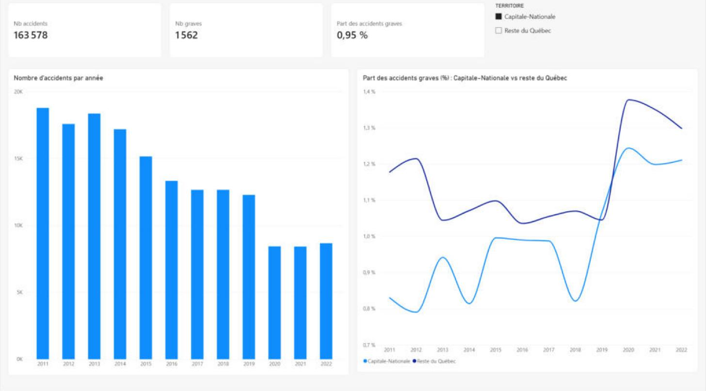
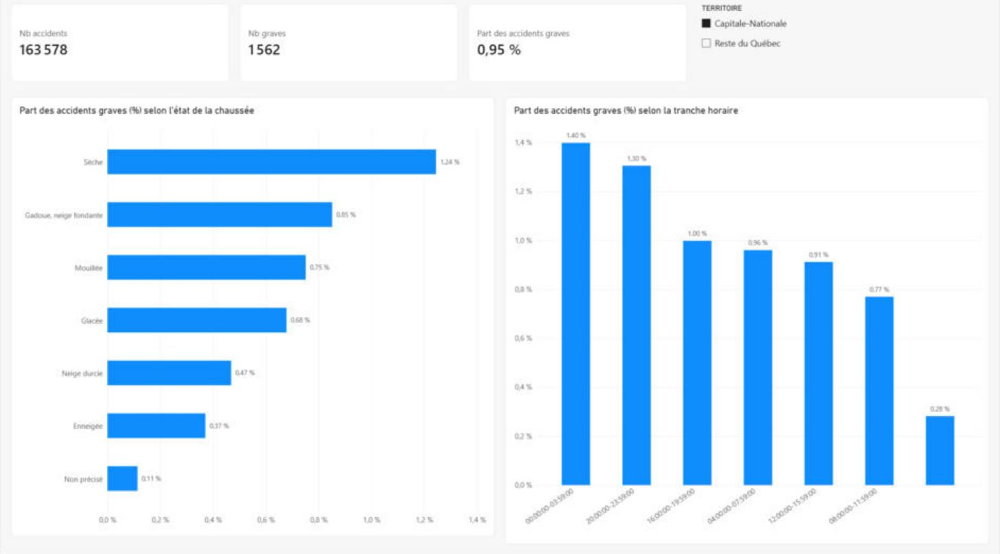
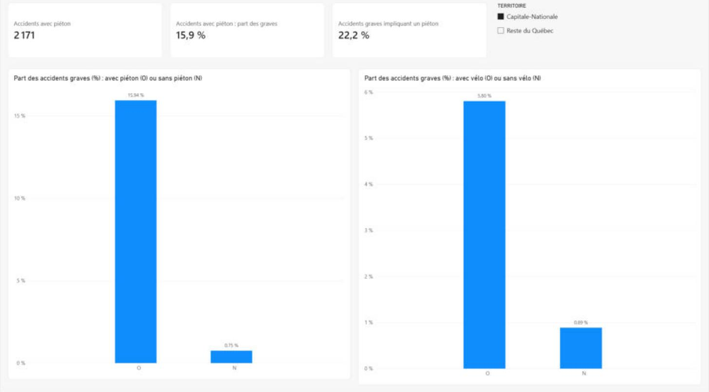

# Accidents de la route dans la Capitale-Nationale (2011-2022)

Analyse de **1,7 million de rapports d'accident de la SAAQ** pour comprendre quand, dans quelles conditions et pour qui les accidents de la route sont les plus graves dans la région de la Capitale-Nationale, comparée au reste du Québec.

**Outils :** Python (pandas) · SQL (SQLite) · Power BI · Claude (IA)

---

## Résultats clés

| # | Question | Constat |
|---|---|---|
| 1 | Comment le nombre d'accidents a-t-il évolué ? | Au Québec, il baisse de **26 %** entre 2011 et 2019 (182 915 → 134 809), puis chute en 2020 avec la pandémie (95 183). |
| 2 | La région se distingue-t-elle du reste du Québec ? | Oui : **0,95 %** d'accidents mortels ou graves dans la Capitale-Nationale contre **1,14 %** ailleurs. La région est sous la moyenne **11 années sur 12** (exception : 2019). |
| 3 | L'hiver rend-il les accidents plus graves ? | Non, c'est l'inverse : **0,37 %** d'accidents graves sur chaussée enneigée et **0,68 %** sur chaussée glacée, contre **1,24 %** sur chaussée sèche. |
| 4 | À quels moments les accidents sont-ils les plus graves ? | La nuit (00 h – 04 h) compte le moins d'accidents, mais la plus forte part d'accidents graves : **1,40 %**, contre 0,77 % le matin (08 h – 12 h). |
| 5 | Quelle est la situation des usagers vulnérables ? | Un accident avec piéton est grave dans **15,9 %** des cas, contre 0,75 % pour les autres (**environ 21 fois plus**). Ces accidents ne représentent que 1,3 % du total, mais **22 % des accidents graves** de la région. Avec un vélo : 5,8 % contre 0,9 %. |

### Interprétation

- **Le paradoxe de l'hiver.** Les routes enneigées et glacées produisent beaucoup d'accidents (26 898 dans la région), mais moins souvent graves. Hypothèse : la *compensation du risque*. Quand le danger est visible, les conducteurs ralentissent, ce qui donne surtout des accidents à basse vitesse.
- **La nuit et l'année 2020.** Sur des routes peu fréquentées, il y a moins d'accrochages, mais des vitesses plus élevées. En 2020, le total des accidents baisse de 29,4 %, alors que les accidents graves ne baissent que de 7,9 % : leur part augmente donc.
- **Les usagers vulnérables** sont l'enjeu principal : peu d'accidents, mais une part disproportionnée des accidents graves.

> Ces explications sont des **hypothèses** : les données ne mesurent ni la vitesse réelle, ni le volume de circulation, ni l'alcool.

---

## Tableau de bord Power BI

Trois pages, filtrables par territoire (Capitale-Nationale / reste du Québec) :

| Conditions à risque | Usagers vulnérables |
|---|---|
|  |  |

Fichier : [`tableau_de_bord_accidents.pbix`](tableau_de_bord_accidents.pbix) (à ouvrir avec Power BI Desktop, gratuit).

---

## Données

- **Source :** [Rapports d'accident – SAAQ, Données Québec](https://www.donneesquebec.ca/recherche/dataset/rapports-d-accident) (licence CC-BY 4.0)
- **Contenu :** une ligne par accident déclaré par la police, avec blessés, ou avec dommages matériels de plus de 2 000 $.
- **Volume :** 12 fichiers annuels, 1 717 407 accidents, dont 163 578 dans la Capitale-Nationale.

### Limites

- La localisation s'arrête à la **région administrative** : le fichier ne contient pas la municipalité. « Capitale-Nationale » désigne donc toute la région (ville de Québec, Portneuf, Charlevoix, etc.), pas seulement la ville.
- L'heure est donnée par **tranches de 4 heures**, et le jour seulement en semaine ou fin de semaine.
- Le fichier ne contient **aucune donnée de circulation**. On compare donc des **proportions** (part des accidents graves) plutôt que des nombres bruts, qui reflètent surtout la taille d'une région ou le volume de trafic.

---

## Démarche

| Étape | Outil | Fichier |
|---|---|---|
| 1. Exploration | Python (pandas) | [`01_exploration.ipynb`](01_exploration.ipynb) |
| 2. Nettoyage et préparation | Python (pandas) | [`02_preparation.ipynb`](02_preparation.ipynb) |
| 3. Création de la base de données | Python + SQLite | [`03_sql.ipynb`](03_sql.ipynb) |
| 4. Analyse | SQL | [`analyses.sql`](analyses.sql) |
| 5. Visualisation | Power BI | [`tableau_de_bord_accidents.pbix`](tableau_de_bord_accidents.pbix) |

### Décisions de nettoyage

- **Noms de colonnes :** retrait des tabulations et guillemets présents dans trois en-têtes (`REG_ADM`, `CD_LOCLN_ACCDN`, `IND_VELO`).
- **Zone de travaux (`CD_ZON_TRAVX_ROUTR`) :** 97 % de cases vides, mais la colonne ne contient que « O ». Une case vide signifie donc « hors zone de travaux » (« N »), et non une donnée manquante.
- **Vitesse permise (`VITESSE_AUTOR`) :** espaces retirés (« 50 » au lieu de « ␣50 ») ; les cases vides sont conservées (vitesse non notée) ; la colonne est traitée comme une catégorie à cause de la valeur « <50 ».
- **Codes traduits en libellés** d'après la documentation de la SAAQ : état de la chaussée, météo, éclairement, mois. Les cases vides deviennent « Non précisé ».
- **Éclairement :** un code 0 non documenté (4 accidents) est classé « Non précisé ».
- **Nombre de véhicules et de victimes :** la valeur 9 signifie « 3 ou plus » ; ces colonnes sont traitées comme des catégories.

### Validation

Les principaux chiffres (totaux, nombre d'accidents graves, pourcentages) ont été **calculés de façon indépendante en Python, en SQL et dans Power BI**, et donnent les mêmes résultats.

---

## Utilisation de Claude (IA)

Ce projet a été réalisé avec **Claude** comme assistant, de façon encadrée :

- **Choix et vérification des sources :** Claude a repéré que le jeu de données « Requêtes 311 » envisagé au départ concernait Montréal et non Québec, puis a lu la documentation officielle de la SAAQ pour en relever les limites.
- **Apprentissage guidé :** j'ai écrit moi-même le code Python et SQL, étape par étape. Claude expliquait chaque notion, relisait mes résultats et m'aidait à interpréter les messages d'erreur.
- **Contrôle des chiffres :** chaque résultat a été recalculé et comparé d'un outil à l'autre avant d'être retenu.
- **Mise en forme et rédaction :** aide à la mise en page du tableau de bord Power BI et à la rédaction de ce README, que j'ai relus et validés.

L'IA m'a fait gagner du temps, mais les décisions d'analyse, les vérifications et l'interprétation restent les miennes.

---

## Reproduire l'analyse

1. Télécharger les 12 fichiers CSV annuels depuis [Données Québec](https://www.donneesquebec.ca/recherche/dataset/rapports-d-accident) et les placer dans un dossier `donnees/`.
2. Exécuter les notebooks dans l'ordre : `01_exploration`, `02_preparation`, puis `03_sql`.
3. Ouvrir `analyses.sql` avec [DB Browser for SQLite](https://sqlitebrowser.org/) sur la base `donnees/accidents.db`.
4. Ouvrir `tableau_de_bord_accidents.pbix` avec Power BI Desktop.

Les données ne sont pas incluses dans ce dépôt, en raison de leur taille (environ 300 Mo).

---

**David Mvondo Medjo** · Analyste de données junior · Québec · [Portfolio](https://zomloa.github.io)
